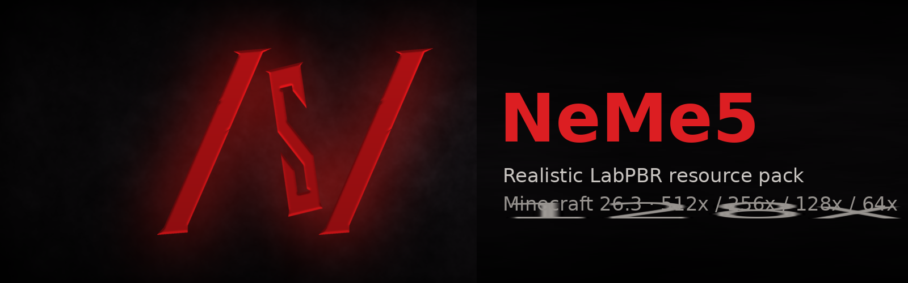

# NeMe5 — реалистичный ресурспак для Minecraft 26.3

Объёмные блоки с картами рельефа и бликов (LabPBR): глубина (POM), отражения металла и камней,
свечение руд, лавы и ламп. Свои 3D-модели растений, кристаллов, сталактитов, фонарей, свечей, рельсов,
дверей и люков. Анимированные огонь, пила камнереза, щупальца скалк-сенсора, вихрь крикуна.

Мобы, броня, инструменты и иконки предметов — ванильные.

---

## 1. Какую версию выбрать

В репозитории четыре папки — это один и тот же пак в разном разрешении.
Чем выше разрешение, тем больше нужно **видеопамяти** — она важнее всего.

| Папка | Разрешение | Размер | Нужно видеопамяти под текстуры |
|---|---|---|---|
| `NeMe5_512` | 512x | ~0,9 ГБ | ~6 ГБ |
| `NeMe5_256` | 256x | ~0,3 ГБ | ~1,6 ГБ |
| `NeMe5_128` | 128x | ~0,12 ГБ | ~0,5 ГБ |
| `NeMe5_64`  | 64x  | ~0,06 ГБ | ~0,25 ГБ |

### Минимальные требования (≈30 кадров с шейдерами, дальность 12 чанков)

> Это **оценка** по объёму текстур и нагрузке шейдеров, а не замер на каждой видеокарте.
> Если кадров мало — опуститесь на одну версию ниже или уменьшите настройки из раздела 4.

| Версия | Видеокарта (минимум) | Видеопамять | ОЗУ | Процессор |
|---|---|---|---|---|
| **512x** | RTX 4070 Ti Super / RX 7800 XT | 16 ГБ | 32 ГБ | i5-12600K / Ryzen 5 7600 |
| **256x** | RTX 3060 / RTX 4060 / RX 6600 XT | 8 ГБ | 16 ГБ | i5-10400 / Ryzen 5 3600 |
| **128x** | GTX 1660 Super / RTX 3050 / RX 6500 XT | 4–6 ГБ | 12–16 ГБ | i5-9400 / Ryzen 5 2600 |
| **64x**  | GTX 1050 Ti / RX 570 | 4 ГБ | 8 ГБ | i3-10100 / Ryzen 3 3100 |

Без шейдеров пак работает на более слабых ПК, но объём и блики видны только с шейдерами.

Сколько памяти выделить игре (в лаунчере, параметр `-Xmx`): 512x — 10–12 ГБ, 256x — 6–8 ГБ, 128x и 64x — 4–6 ГБ.

---

## 2. Что нужно установить

Обязательно:
- **Minecraft 26.3** на **Fabric**
- **Sodium** и **Iris** (версии для 26.3)
- шейдер с поддержкой LabPBR — рекомендую **Complementary Reimagined** или **Complementary Unbound**

По желанию:
- **OptiGUI** — свои интерфейсы у разных сундуков (обычный, ловушка, эндер, медные стадии, бочка).
  Сейчас OptiGUI для 26.3 ещё не вышел; файлы в паке уже есть и включатся сами, когда он появится.

---

## 3. Установка

### Вариант А — просто скачать (проще всего)
1. Наверху этой страницы нажмите **Code → Download ZIP**.
2. Распакуйте архив.
3. Возьмите **одну** папку нужного разрешения (например `NeMe5_256`) и положите её целиком в
   `%APPDATA%\.minecraft\resourcepacks\`
4. В игре: **Настройки → Пакеты ресурсов** → перенесите NeMe5 вправо → **Готово**.

Внутри папки сразу должны лежать `pack.mcmeta` и `assets` — если там ещё одна папка, поднимите содержимое на уровень выше.

### Вариант Б — через git (чтобы обновляться одной командой)
В PowerShell:
```powershell
cd $env:APPDATA\.minecraft
git clone https://github.com/neme51s/NeMe5_RP.git NeMe5_RP
foreach ($v in 512,256,128,64) {
  New-Item -ItemType Junction -Path "resourcepacks\NeMe5_$v" -Target "NeMe5_RP\NeMe5_$v" -Force
}
```
Обновление:
```powershell
cd $env:APPDATA\.minecraft\NeMe5_RP
git pull
```
затем в игре **F3 + T**.

---

## 4. Настройка шейдера (Complementary)

**Настройки → Видео → Пакеты шейдеров → Complementary → Настройки шейдера.**
Названия пунктов могут немного отличаться в разных версиях шейдера.

### Обязательно
| Где | Что поставить |
|---|---|
| Materials / Материалы → **Material Format** (Resource Pack Support) | **LabPBR** |
| Materials → **Normal Mapping** | Включено |
| Materials → **Specular / Reflections** (Advanced Materials) | Включено |
| Materials → **Generated Normals** | **Выключено** (иначе шейдер наложит свой рельеф поверх пака) |
| Materials → **Auto-generated / Integrated Emission** | Выключено (свечение задаёт пак) |

### Глубина (POM)
| Пункт | Рекомендуемо | Если не хватает кадров |
|---|---|---|
| **POM / Parallax Occlusion Mapping** | Включено | Включено |
| **POM Depth** | 0,7–1,0 | 0,5 |
| **POM Quality (samples)** | 64 | 16–32 |
| **POM Distance** | 32 | 16 |
| **POM Shadows / Self-shadowing** | Включено | Выключено |

### Если кадров всё ещё мало
- уменьшите **Shadow Distance** и **Shadow Resolution** (больше всего влияют на FPS);
- выключите **Volumetric Light** и **Screen-space Reflections** на средних картах;
- в видеонастройках: **Дальность прорисовки** 8–10, **Mipmap** 4;
- опуститесь на версию пака ниже (512 → 256 → 128).

### Если что-то выглядит неправильно
- **Нет объёма и бликов** — не выбран LabPBR или выключены Normal/Specular.
- **Блоки «прыгают» и рябят** — уменьшите POM Depth.
- **Фиолетово-чёрные блоки** — пак не догрузился: нажмите F3 + T; если не помогло — пришлите скриншот.

---

## Версии
Номер версии написан в описании пака в списке пакетов ресурсов (например «v29»).
